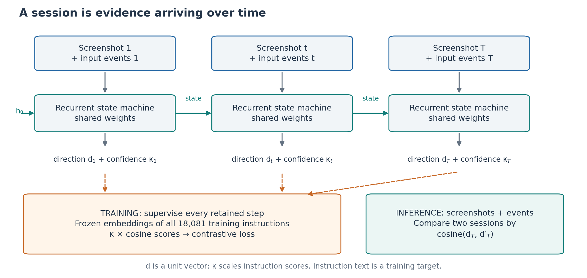
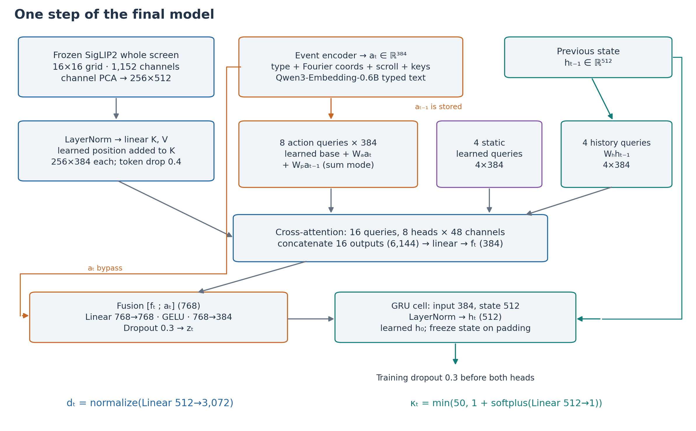
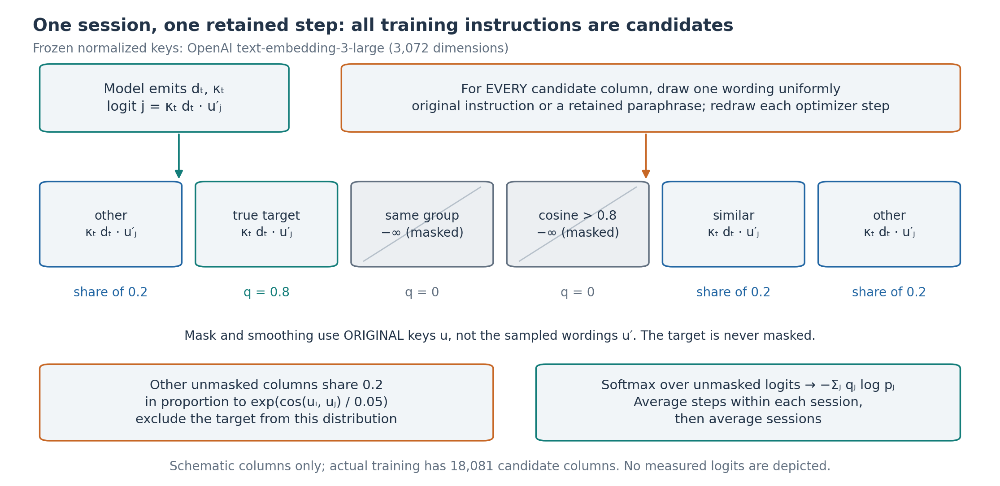
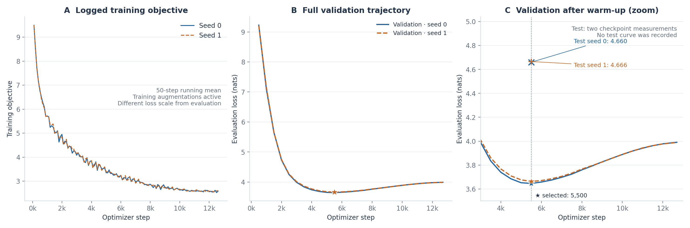
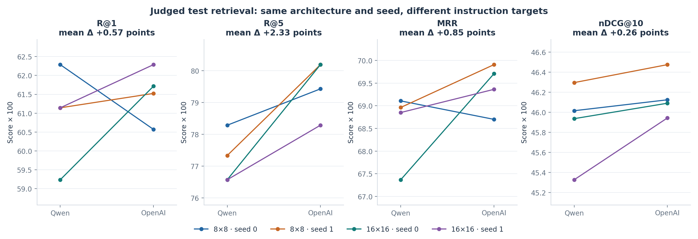
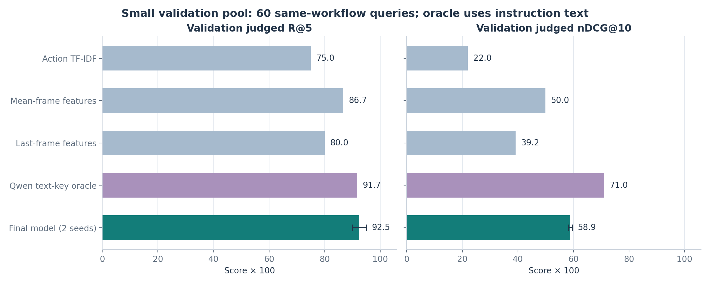
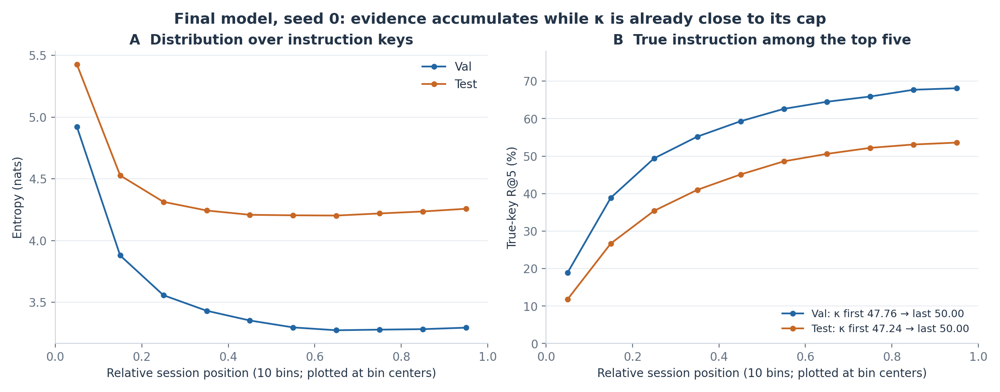
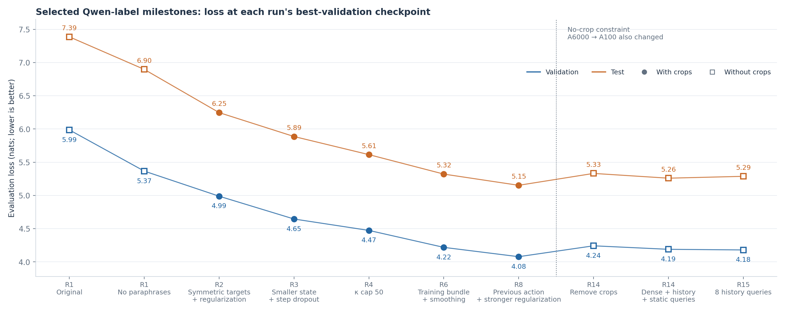
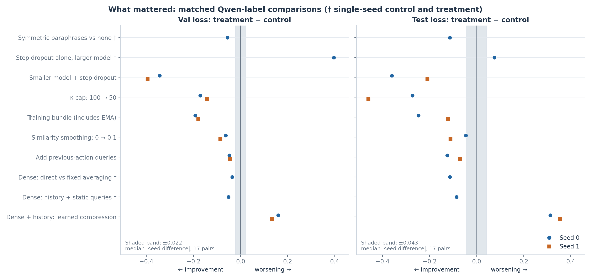
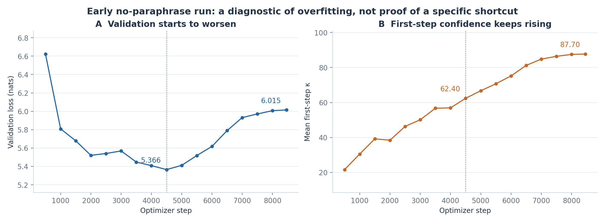

# Inferring workflows from screens and actions: a recurrent session embedding

## Abstract

We study whether a model can infer a user's workflow as a computer-use session unfolds. A recurrent model reads screenshots and input events, predicts a direction in a frozen instruction-embedding space, and uses its final direction to retrieve similar sessions. Development exposed two problems: asymmetric paraphrase augmentation offered a possible wording shortcut, and duplicate-instruction retrieval rewarded visual resemblance too easily. We repaired the augmentation, introduced trace-judged retrieval, and reduced overfitting before adding contextual visual attention. The final model has 10,940,161 trainable parameters and uses dense whole-screen features, action and history queries, and OpenAI instruction targets. Across two seeds, judged test recall at five is 79.2% and mean reciprocal rank is 0.695 on applications held out from training. Confidence remains near its cap even early in sessions, so improving predictions do not establish calibrated uncertainty. Results are limited by seed variability and incomplete automated relevance judgments.

## 1 Introduction

A screenshot can reveal which application is open without revealing what someone is trying to accomplish. Actions add evidence: a search, a selection, and an edit together can distinguish workflows that initially look alike. Our aim is to turn that unfolding evidence into a compact representation that supports session retrieval without requiring an instruction at inference.

The original design was a gated recurrent unit (GRU) trained at every step against frozen text embeddings of instructions. It emitted an intent direction and a scalar confidence, κ. We kept this framework, but the experiments changed how it attends to screens, constructs its targets, and controls memorization. We report an empirical recipe and why its parts were retained. It does not demonstrate calibrated confidence on ambiguous prefixes.

There are two related tasks here. Predicting the recorded instruction tests whether a session representation aligns with its supervision. Retrieving another session tests whether it captures a procedure shared across demonstrations. Instructions that differ in concrete values can describe the same workflow, so exact instruction retrieval is an incomplete measure of the intended behavior. We therefore report both kinds of evidence and use the common judged session benchmark when changing instruction encoders.



**Figure 1. Approach overview.** Every retained training step receives instruction supervision; inference compares final unit directions by cosine similarity. Instructions are targets, while typed text remains an input.

## 2 Problem and data

We use AgentNet computer-use trajectories. Filtering retains 22,083 of 22,625 sessions, with 408,384 steps: 449 sessions fail the instruction-alignment filter and 93 repeat a task identifier. Failed task attempts remain valid examples of intended workflows. The preparation code also checks repeated image sequences and minimum trajectory length. It removes termination events while retaining their screenshots; the dataset has no separate final screenshot to append.

Normalized, lowercase instruction strings define duplicate groups. Groups do not cross splits. Training contains 18,081 sessions, validation 952, and test 3,050. Test holds out 157 application/site keys, including sessions that mention those keys as secondary applications. Group closure moves three additional sessions into test. Validation instead holds out instruction groups among the remaining applications. Thus test measures a different, harder generalization setting. The sampler excludes very large application keys from selection, so this is not a uniform sample of unseen applications.

Events are parsed from action code, with cursor position carried between steps. Coordinates are clipped to [0, 1]; missing coordinates remain explicitly marked. Each step retains at most eight events and each event at most four key tokens. Event truncation affects 298 steps. The vocabulary contains 105 key tokens and 20,557 distinct typed strings. The model consumes these structured events and screen features; application and operating-system metadata are not direct model inputs.

## 3 Method: the final model and its motivations

### 3.1 Frozen inputs and contextual visual attention

The final screen encoder is `google/siglip2-so400m-patch16-naflex`. Aspect-preserving preprocessing permits up to 1,024 patches; the resulting spatial features are adaptively averaged to a 16×16 grid. A centered principal component analysis (PCA), fitted using training-frame tokens, reduces each token from 1,152 to 512 channels. The recurrent model therefore receives 256×512 features per screenshot. There are no click-centered crops or learned token compressor. Dense direct attention improved loss over fixed averaging of the same cache in one seed; learned compression worsened the tested comparisons. This supports retaining spatial detail, although the proposed explanation—that early compression loses query-relevant locations—remains untested.

Each event becomes a 384-dimensional vector by adding a type embedding, projected Fourier coordinates with presence indicators, scroll features, summed key-token embeddings, and projected typed-text features. The coordinate encoding uses 16 frequencies per coordinate; scroll features are sign and log magnitude. Typed strings use frozen, normalized 1,024-dimensional `Qwen/Qwen3-Embedding-0.6B` embeddings. A residual multilayer perceptron (MLP), with layer normalization and a 384→768→384 transformation, processes each event before events are summed. Event-free steps use a learned vector.

The screen pool has sixteen 384-dimensional queries. Eight combine a learned base with separate projections of the current and previous action vectors, added together. Four are static learned queries; four are projected from the previous 512-dimensional recurrent state. The previous action helps inspect its effect in the current screen: this change improved both losses in two seeds. History and static queries were added together to make inspection sensitive to accumulated evidence and independent of the current action. Their gains were small and directionally consistent, but the controls were not replicated.

Screen tokens pass through layer normalization and separate key/value projections to width 384. Learned spatial positions are added to attention keys only. Eight attention heads, each of width 48, read the tokens; the sixteen outputs are concatenated and projected from 6,144 to 384 dimensions. History queries make pooling sequential, although screen keys, values, and action queries can be prepared in parallel.



**Figure 2. Final architecture.** Current and previous actions share eight queries; static and history queries are additional groups. Events also bypass attention into fusion. PCA preserves 256 spatial tokens. GELU denotes the Gaussian error linear unit activation.

### 3.2 State, direction, and confidence

Fusion concatenates pooled vision and events, then applies linear 768→768, GELU, and linear 768→384 layers. A single GRU cell maps this input and the previous state to a 512-dimensional state, followed by layer normalization. The initial state is learned and initialized to zero; padding freezes the state. Dropout acts on fusion outputs and separately on states supplied to the readout, leaving the recurrently carried state undropped.

The direction head projects 512→3,072 and normalizes to unit length. The scalar head produces

$$
d_t=\operatorname{normalize}(W_dh_t+b_d),\qquad
\kappa_t=\min\{50,\;1+\operatorname{softplus}(w_\kappa^Th_t+b_\kappa)\}.
$$

These equations describe inference; training applies the readout dropout first. Confidence starts at 5. Smaller state capacity and the cap of 50 were retained because they reduced overfitting in replicated comparisons. We retain one direction: mixture readouts did not improve the tested recipe. At inference, sessions are ranked by cosine between final directions; κ does not enter this ranking.

The computation is causal: history queries use the state before the current update. In the complete sequence, the previous action provides a cue to what changed in the current screen. Streaming inference needs that action vector and the recurrent state, rather than an expanding store of earlier frames. The frozen encoders supply features for newly observed screens and typed strings; an instruction candidate bank is needed for the training diagnostic, not for session-to-session cosine retrieval.

### 3.3 Symmetric contrastive supervision

The final target encoder is frozen `text-embedding-3-large`, producing normalized 3,072-dimensional instruction keys. Typed-text inputs remain Qwen embeddings. We changed targets after observing improved judged retrieval across matched configurations; loss values across these two label spaces are not comparable.

Training uses information noise-contrastive estimation (InfoNCE), implemented as cross-entropy over all 18,081 training-session instruction columns, rather than only the current batch. Each optimizer step independently samples an original wording or retained paraphrase uniformly for every candidate column. The same sampled bank serves all sessions and time steps in that update. Earlier positive-only paraphrasing worsened validation loss; symmetric sampling removes the proposed wording-style distinction between positive and negative columns.

For target session i, mask candidate j when it shares the instruction group or its original-key cosine exceeds 0.8; never mask i itself. Masking uses original keys even when scoring sampled paraphrases. Similarity-based smoothing assigns 0.8 target mass to i and distributes 0.2 over the other unmasked candidates in proportion to exp(cos(uᵢ,uⱼ)/0.05). Excluding the target from this distribution prevents self-similarity from absorbing the smoothing mass. Logits are κₜ times direction–key cosine. Loss averages retained steps within each session, then sessions within the batch.



**Figure 3. Training objective.** Every column receives the same wording augmentation policy. Masked candidates receive neither probability nor smoothing mass; the true target is protected. The schematic shows selected columns, not measured logits. Both masking and smoothing use original keys.

## 4 Experimental setup

The final recipe uses fusion/readout dropout 0.3, token dropout 0.4, and step dropout 0.4. Token dropout masks attention sources while forcing at least one token to survive. Step dropout preserves order and the final step, but can drop the opening step. Consequently, previous-action queries use the previous **retained** action during training, which need not have produced the current screenshot. Evaluation uses complete sessions without dropout. The successful regularization is a combination: step dropout alone hurt the larger model.

AdamW (adaptive moment estimation with decoupled weight decay) uses learning rate 0.0005, moment coefficients (0.9, 0.98), and weight decay 0.1 for matrices whose parameter names do not contain `emb`; other parameters receive no decay. Gradients are clipped to norm 1. A 500-step linear warm-up precedes cosine decay. Training uses bfloat16 model computation and 32-bit loss computation. Cached frames reside on the graphics processing unit (GPU) in 8-bit floating point and are converted to bfloat16 per batch. Frozen encoders are not trained.

Length-bucketed batches target 64 sessions and split large batches to respect a 4,096 padded-frame budget without truncating trajectories. Both seeds run 12,690 updates, derived from a nominal 45 epochs; variable batch splitting means this is a step budget rather than exactly 45 dataset passes. An exponential moving average (EMA) of weights with decay 0.999 is evaluated every 500 updates and at completion. Minimum validation loss selects the checkpoint, at step 5,500 for both final seeds. Appendix A supplies the full settings.

Evaluation loss is unsmoothed cross-entropy against original training keys plus the evaluated split's keys: 19,033 validation candidates or 21,131 test candidates. It retains false-negative masking and equal session weighting. It uses neither paraphrase sampling nor training augmentation. Final-step instruction retrieval is a separate diagnostic from session retrieval.

Session relevance comes from a pool proposed by instruction similarity, action similarity, same-application random sampling, and duplicate groups. A large language model (LLM), Claude Opus 5.5, judges instructions, application context, and natural-language step traces as same workflow, related, or different. Duplicate groups receive the highest label. Recall at k (R@k) and mean reciprocal rank (MRR) use queries with a same-workflow partner: 60 validation and 525 test queries. Normalized discounted cumulative gain at ten (nDCG@10) instead includes queries with any positive graded label, using gains 2^label−1. Unjudged pairs count as irrelevant. All reported session metrics search the full split, excluding self-matches; the export suffix `cross_app` does **not** exclude same-application candidates.

Baselines include action n-grams with term frequency–inverse document frequency (TF-IDF), untrained mean/last-frame features, and a Qwen instruction-key oracle. The oracle sees the instruction and is not deployable under our inference assumptions. A ridge regression baseline maps aggregated frame/action features to Qwen keys, but its export supplies instruction retrieval only. Baseline judged metrics exist for validation only; no judged test baseline comparison is available.

## 5 Results

### 5.1 Final performance and learning dynamics

Table 1 gives seed means and observed ranges, not confidence intervals. The final dense model reaches 79.2% judged test R@5. The crop reference remains competitive, particularly on graded retrieval; the final model implements the later no-crop constraint, rather than establishing superiority over every earlier system. The absolute best crop-era validation run is also shown, with unavailable judged metrics left blank.

**Table 1. Selected-checkpoint results.** Recall is in percent; MRR and nDCG are fractions. Parentheses give the range across two seeds. Qwen and OpenAI losses must be read within their own target spaces. All judged columns are test metrics.

| Model / targets | Val loss | Test loss | R@1 | R@5 | MRR | nDCG@10 |
|---|---:|---:|---:|---:|---:|---:|
| **Final: dense + history / OpenAI** | **3.655 (3.646–3.663)** | **4.663 (4.660–4.666)** | **62.0 (61.7–62.3)** | **79.2 (78.3–80.2)** | **0.695 (0.694–0.697)** | **0.460 (0.459–0.461)** |
| Dense + history / Qwen | 4.200 (4.189–4.211) | 5.275 (5.260–5.290) | 60.2 (59.2–61.1) | 76.6 (76.6–76.6) | 0.681 (0.674–0.689) | 0.456 (0.453–0.459) |
| 8×8 + history / Qwen | 4.210 (4.197–4.223) | 5.299 (5.277–5.321) | 61.7 (61.1–62.3) | 77.8 (77.3–78.3) | 0.690 (0.690–0.691) | 0.462 (0.460–0.463) |
| Crop reference / Qwen | 4.092 (4.078–4.106) | 5.146 (5.139–5.152) | 62.4 (62.1–62.7) | 80.1 (78.9–81.3) | 0.703 (0.698–0.707) | 0.476 (0.474–0.478) |
| Lowest-val crop variant, κ cap 75 / Qwen (one seed) | 4.068 | 5.152 | — | — | — | — |

Both final validation curves reach their minimum well before training ends, then rise to approximately 3.99. Meanwhile, the logged training objective continues falling. This is evidence of overfitting despite regularization and EMA. Test loss at selection is about one nat higher than validation loss. Whole-application holdout makes this gap plausible, but the larger test candidate bank and different session composition also contribute; the gap does not isolate application shift.



**Figure 4. Final learning curves.** Stars mark the selected checkpoints; crosses mark the only test-loss observations. The training objective includes smoothing, augmentation, dropout, and training-only candidates, so its vertical scale is not comparable to evaluation loss. The zoom reveals the validation minimum and subsequent rise. There is no test-loss curve.

### 5.2 Target space and baseline comparisons

Across four matched architecture/seed pairs, switching from Qwen to OpenAI targets improves judged test R@5 in every pair, averaging 77.2%→79.5%. Individual gains range from 1.1 to 3.6 percentage points. The four-pair average includes both dense and 8×8 models, explaining why it differs from the final model's two-seed mean. Average changes in R@1, MRR, and nDCG@10 are comparable to seed variability. This comparison changes output dimensionality and false-negative masking as well as embedding semantics, so it cannot identify which property caused the gain.



**Figure 5. Changing instruction targets.** Each line preserves architecture and seed. R@5 improves consistently; R@1 and MRR have mixed directions, and nDCG gains are small. Scores are multiplied by 100. Judged metrics support comparison across label spaces; instruction losses do not.

**Table 2. Baseline context.** Validation judged R@1/R@5 use only 60 queries; graded nDCG uses its broader positive-label query set. Test columns measure duplicate-instruction retrieval on 74 queries, **not judged workflow retrieval**. Final-model entries average two seeds. No baseline judged test numbers were exported.

| Representation | Val judged R@1 (%) | Val judged R@5 (%) | Val judged MRR | Val judged nDCG@10 | Test duplicate R@1 (%) | Test duplicate R@5 (%) |
|---|---:|---:|---:|---:|---:|---:|
| Action TF-IDF | 68.3 | 75.0 | 0.725 | 0.220 | 85.1 | 89.2 |
| Mean-frame | 78.3 | 86.7 | 0.811 | 0.500 | 90.5 | 95.9 |
| Last-frame | 65.0 | 80.0 | 0.705 | 0.392 | 87.8 | 94.6 |
| Qwen text-key oracle | 65.0 | 91.7 | 0.755 | 0.710 | 100.0 | 100.0 |
| Final model | 83.3 | 92.5 | 0.875 | 0.589 | 89.2 | 95.9 |

The final model exceeds the visual and action baselines on validation judged metrics, while the oracle retains higher graded nDCG. The small pool limits that conclusion. Mean-frame features already retrieve all 29 validation queries' duplicate-instruction partners at rank one. This motivated judging procedures rather than relying on instruction duplication. The earlier notes attribute the shortcut to repeated tasks on the same machine; these exports alone cannot prove that cause. Test duplicate retrieval likewise gives little evidence of an advantage over raw visual features.



**Figure 6. Validation baseline comparison.** Error bars show the final model's two-seed range. The oracle's stronger graded retrieval and the strong mean-frame baseline qualify the improvement. The 60-query count applies to same-workflow recall, not to the broader nDCG query set.

### 5.3 What changes over a session?

For the final model's exported seed, validation entropy falls from 4.92 to 3.29 nats across relative-position bins, while true-key R@5 rises from 18.9% to 68.1%. Test shows the same broad pattern at lower recall. Entropy levels off and rises slightly late in sessions. These bins pool steps across trajectories and are not exact endpoints or individual examples.

Yet κ starts at 47.76 on validation and ends at 50. Directional alignment therefore plausibly carries much of the changing uncertainty. This is an inference, not a measurement separating the direction and confidence mechanisms. The crop reference shows the same qualitative pattern in both seeds. Neither observation demonstrates calibrated uncertainty on deliberately ambiguous prefixes.



**Figure 7. Uncertainty over a session.** Entropy generally declines and true-key recall rises, despite κ already being near its cap. Only seed 0 of the final model has position-binned exports. Annotated κ values are actual first/last-step averages; intermediate κ values are not inferred.

## 6 How we got here

The early experiments suggested that stronger confidence was not necessarily better inference. Removing positive-only paraphrases reduced validation loss from 5.99 to 5.37. Symmetric paraphrasing then modestly beat no paraphrases with crops. These single-seed comparisons support the wording-shortcut hypothesis without directly proving it. An early no-paraphrase run's first-step κ rose from 62 to 88 after its validation minimum, while loss worsened from 5.37 to 6.02. We responded by controlling capacity and regularizing the sequence.



**Figure 8. Development arc.** Selected milestones show best-validation checkpoints and their test losses, not a controlled cumulative ablation or every round's winner. Filled circles use crops; open squares do not. The later no-crop pivot also changed hardware. Only Qwen-label losses are plotted.

Smaller capacity plus step dropout, the confidence cap, and similarity smoothing each improved both losses in two seeds. A bundle containing EMA, lower learning rate, more queries, longer training, and stronger step dropout also replicated. EMA alone and token dropout were not seed-replicated. Across 17 configuration-matched seed pairs, median absolute differences are 0.022 validation and 0.043 test loss. These are context for small changes, not significance thresholds.



**Figure 9. What mattered.** Negative differences favor the treatment; each dot is a matched comparison. Shading shows median absolute seed differences, computed within configurations across the historical recipes. It is not a confidence interval. The training-bundle row cannot assign its gain to EMA alone; the history row adds static queries too.



**Figure 10. Why regularization became central.** After the validation minimum, first-step confidence keeps rising. This supports overfitting, but does not establish which visual cues were memorized. Unlike Figure 4, this diagnostic uses an early Qwen-label run.

Previous-action attention broke the next plateau. Extra recurrence and mixture directions did not improve the recipe, and following-frame action crops offered no convincing test benefit. Removing click crops later cost about 0.16 validation loss, with hardware changing too. Dense features and contextual queries recovered some loss, but nearby no-crop variants remain close at observed seed variability. Direct dense attention beat fixed averaging in loss without improving graded retrieval. These results favor a compact contextual reader; they do not establish a universal advantage for more tokens or more capacity.

## 7 Limitations and next steps

The relevance pool is incomplete and LLM-judged, and unjudged matches receive no credit. Its construction can favor the retrievers that proposed pairs. Validation is especially small, many controls have one seed, and repeated development comparisons do not constitute an untouched confirmatory test. Dense-cache comparisons with the original features also change channel PCA; the direct-versus-averaged comparison within that cache avoids this particular confound.

Two final seeds describe reproducibility only narrowly. Their observed range is not a population uncertainty estimate, and the historical median seed difference should not turn a small gain into a statistical claim. Likewise, aggregate position curves can hide sessions whose predictions become worse. Without per-session outputs, we cannot inspect such failures or establish which screen details the attention queries actually use.

Next steps are to audit and expand judgments with human review, evaluate all baselines on judged test data, and replicate missing controls. Deliberately ambiguous prefixes would test whether confidence responds to missing evidence. The alternative Qwen2.5-VL vision-encoder comparison remains unfinished after preprocessing bottlenecked caching; it has no comparative training result. No screenshots or per-session predictions are available here, so the diagrams explain computation rather than presenting fabricated examples.

## Appendix A. Full final configuration

Values come from the two final entries in [runs.json](data/runs.json), with fixed implementation details from [model.py](../wfemb/model.py), [train.py](../wfemb/train.py), and preprocessing code. Their effective settings match except for seed and run name. The final run identifiers are `r16_oai_dense_hist` and `r16_oai_dense_hist_seed1`.

| Component / flag | Final value or exact behavior |
|---|---|
| Trainable parameters, `n_params` | 10,940,161; excludes frozen encoders and non-parameter text buffers |
| Seeds | 0, 1 |
| `frames_dir` | `/nas/ttl=60d/dfeng/workflow-embeddings/frames_dense` (recorded artifact location; not accessed for this report) |
| `keys_dir` | `/nas/ucb/dfeng/data/workflow-embeddings/keys_openai` (recorded artifact location) |
| `frames_mode` | `gpu_fp8`: clamp to ±448, cast to float8_e4m3fn; gather as bfloat16 |
| Vision encoder and grid | `google/siglip2-so400m-patch16-naflex`; 1,024-patch preprocessing budget; adaptive average pooling to 16×16; 256 tokens |
| Channel PCA | Center 1,152-channel tokens and project onto 512 leading covariance eigenvectors; fitted on training frames only; no whitening |
| PCA sampling implementation | Seed 0, without replacement; `pca_frames` default 16,000. The historical cache command/fit artifact is not exported, so the actual fit sample count is not independently verified here |
| `use_crop`, `use_effect`, `extra`, `avg_grid` | `false`, `false`, empty, `0` |
| `d`, `h`, `gru_layers` | 384, 512, 1 |
| `n_queries`, `prev_query` | 8, `sum`; separate current/previous projections to 8×384; first-step previous action is the learned no-event vector |
| `static_queries`, `hist_queries` | 4, 4; concatenation order: action, static, history |
| `n_heads`, head width | 8, 48; standard softmax(QKᵀ/√48)V attention |
| `compress_latents`, `compress_blocks` | 0 (disabled), 1 (inactive setting) |
| Event types / key vocabulary | 20 type slots including padding and removed termination type; 105 key tokens, including pad/unknown |
| Event limits | 8 events/step; 4 key tokens/event; scroll clipped to ±1,000 |
| Fourier coordinates | Four coordinates, 16 frequencies π·2ʲ for j=0,…,15; sine and cosine; missing-coordinate masking; 128 encoded values + 4 presence indicators → 384 |
| Event transforms | Type/key embeddings width 384; scroll `[sign(s), log(1+abs(s))]` → 384; text 1,024→384; sum, then residual LayerNorm→384→768→GELU→384; sum present events |
| Typed-text encoder | `Qwen/Qwen3-Embedding-0.6B`, normalized embeddings, maximum 128 tokens; cached float16 vectors, cast to float for event encoding |
| Frozen instruction encoder | `text-embedding-3-large`, 3,072 dimensions, normalized; Qwen comparisons use 1,024 dimensions |
| `n_mix`, `keep_bias` | 1 direction, 0 added GRU update-gate bias |
| `k_min`, `k_max`, fixed `k_init` | 1, 50, 5; confidence-head weights initialized to zero |
| `dropout`, `tok_drop`, `step_drop` | 0.3, 0.4, 0.4 |
| `step_drop_anneal`, `max_len` | 0 (no annealing), 0 (no truncation) |
| `batch`, `max_frames` | 64 target sessions, 4,096 padded frames; long-session batches split, not sessions |
| Bucketing | Shuffle; sort lengths within buckets of 50×64 sessions; form batches; omit incomplete nominal batches; shuffle batch order |
| `lr`, `wd` | 0.0005, 0.1; decay only parameters with ≥2 dimensions and no `emb` in the name |
| AdamW | β₁=0.9, β₂=0.98; other optimizer options use library defaults; gradient norm cap 1 |
| `warmup`, scheduler | 500 steps; multiplier `(step+1)/500` during warm-up, then half-cosine to zero |
| `epochs`, `total_steps`, `max_steps` | 45 nominal; 12,690 = 45×floor(18,081/64); 0 override |
| `ema` | 0.999; EMA starts as model copy; parameters averaged each update, buffers copied; EMA used for evaluation/checkpoints |
| `theta_fn`, `eval_theta_fn` | 0.8, 0.8; Qwen comparisons use 0.9 |
| `no_para`, `para_negatives`, `center_keys` | `false`, `true`, `false` |
| Paraphrase generation implementation | `Qwen/Qwen2.5-7B-Instruct`; requested 6 rewrites, temperature 0.9, top-p 0.95; preserve app/site names and concrete values ([paraphrase.py](../wfemb/paraphrase.py)) |
| OpenAI paraphrase filtering | Retention fraction 0.927; exported cosine threshold 0.801958859; 118,158 of 127,463 session-associated candidate paraphrases retained across all splits, covering 20,862 sessions. Only training-session wordings enter training |
| `label_smooth`, `smooth_tau` | 0.2, 0.05; original-key similarity; true column excluded from smoothing distribution |
| `eval_every`, `log_every`, `select_on` | 500, 50, `loss`; evaluation also at last update |
| Selected checkpoint | Step 5,500 for both seeds; test scored at that checkpoint only |

Preparation uses normalized-whitespace/lowercase instruction groups. The application sampler's default target is 10% of sessions, excluding primary keys larger than 1.5% of the dataset; inclusion by secondary keys and duplicate-group closure changes the realized fraction. Validation's default target is 5% of remaining sessions, selected by whole groups. The available dataset summary establishes the realized counts, rather than the original nominal fractions.

The judging code defaults to four Qwen instruction neighbors, two action neighbors, one same-application random candidate, and all duplicate-group partners per query; unordered pairs are deduplicated and presentation order randomized. These are code defaults, not an independently exported invocation log. Label 2 means the same goal and essentially the same procedure in the same application/site, allowing changes in concrete values or minor step ordering. Label 1 means partly overlapping procedures in the same application with different goals or substantial subtask differences; label 0 means different. Recall is a query-level hit rate: at least one label-2 result among the first k. MRR uses the first label-2 result's rank. nDCG discounts rank r by 1/log₂(r+1).

The action baseline fits 1–3-gram TF-IDF on training sessions, with sublinear counts and minimum document frequency 2, then reduces to 256 dimensions using truncated singular value decomposition. Locations are binned on a 4×4 grid. Ridge uses standardized mean-frame, last-frame, and reduced action features; α=10 gives validation/test instruction R@5 of 0.273/0.180. These are not judged session metrics.

## Appendix B. Departures from the original specification

The starting point is [PSEUDOCODE_v1.md](PSEUDOCODE_v1.md). The earlier [RESULTS.md](RESULTS.md) records development hypotheses; [SUMMARY.md](SUMMARY.md) supplies the checked narrative and more cautious interpretations used here.

| Original design | Final implementation and reason |
|---|---|
| Paraphrases replace only the positive | Every candidate samples a wording. Positive-only augmentation worsened loss; a style shortcut is a supported hypothesis, not directly measured |
| Unspecified frozen text encoder; common target/input space | OpenAI instruction targets, Qwen typed-text inputs. Matched judged retrieval motivated the change; dimension, masking, and paraphrase filtering also change |
| Approximate false-negative threshold | 0.9 for Qwen, 0.8 for OpenAI; avoids using one cosine threshold across geometrically different spaces |
| Current-event-conditioned visual pooling | Current plus previous action, with separate static and recurrent-history queries; action effects and accumulated evidence motivate the additions |
| Fixed pooled screen tokens; optional visual upgrade | Final 16×16 whole-screen cache with channel PCA. Crops helped earlier but were removed from scope; learned compression did not improve results |
| Minimal regularization | Smaller state, two forms of model dropout, step dropout, confidence cap, smoothing, and EMA, responding to overfitting |
| Append a separate final screenshot | Keep the existing termination-step screenshot and remove the event; no extra screen exists to append |
| Optional mixture for multimodal intent | One direction retained. Tested mixtures worsened loss; this does not resolve the theoretical ambiguity question |
| Low κ is the only way to spread probability | Not supported: direction can change relative similarities while κ stays high. No calibration claim follows from falling entropy alone |
| Select by validation session recall | Select EMA checkpoint by validation instruction loss. The small judged validation pool motivates caution, but the exports do not isolate the effect of this selection choice |
| Independent retrieval and an external WONDERBREAD test | Trace-judged and duplicate-group retrieval are available; no external benchmark result is exported. Teacher-space loss remains a diagnostic and selection metric |
| Feature-readability check, possible vision fine-tuning | No matched decisive-detail probe or vision fine-tuning result is available. Frozen encoders remain part of the final setup |

## Appendix C. Evidence, runs, and regeneration

### C.1 Metric precedence and audit limits

All tables and data figures use [runs.json](data/runs.json), [train_curves.json](data/train_curves.json), [curves.json](data/curves.json), [baselines.json](data/baselines.json), [dataset_summary.json](data/dataset_summary.json), or [keys_openai_meta.json](data/keys_openai_meta.json). For a split, use `reeval_*` before `final_*`, then `best_val` only as a validation fallback. Corrected reevaluations are especially important for the crop reference. `best_val` is a record at the loss-selected checkpoint; do not combine unrelated per-metric maxima. The final learning-curve test markers explicitly use `final_test.loss`.

`train_curves.json` exports sampled log records: each training objective is already a running mean over the preceding 50 optimizer steps; no additional smoothing is applied in Figure 4. Validation records are stepwise evaluations. No matched evaluation-mode training curve and no test curve exist. The note mentioning a later curve-logging round does not establish results from that canceled round.

### C.2 Main evidence map

| Claim / output | Run identifiers or source |
|---|---|
| Final model, Table 1, Figures 1–4 | `r16_oai_dense_hist`, `r16_oai_dense_hist_seed1`; [r16.txt](../sweeps/r16.txt); [model.py](../wfemb/model.py), [loss.py](../wfemb/loss.py), [train.py](../wfemb/train.py) |
| Inputs and splitting | [prepare.py](../wfemb/prepare.py), [actions.py](../wfemb/actions.py), [cache_frames.py](../wfemb/cache_frames.py), [text_embed.py](../wfemb/text_embed.py), [openai_keys.py](../wfemb/openai_keys.py), dataset/key metadata |
| Dropout, batching, evaluation | [data.py](../wfemb/data.py), [evaluate.py](../wfemb/evaluate.py) |
| Judging and baselines | [judge_pool.py](../wfemb/judge_pool.py), [baselines.py](../wfemb/baselines.py), `baselines.json`; `jsession_*_cross_app` versus `session_*_cross_app` |
| Qwen dense reference | `r14_dense_hist`, `r15_dense_hist_seed1` |
| Qwen 8×8 reference | `r14_nocrop_hist`, `r15_nocrop_hist_seed1` |
| Replicated crop reference | `r8_prevq_reg_ls20`, `r9_best_seed1`; use `reeval_val`/`reeval_test` |
| Absolute lowest crop validation loss | `r9_k75`; single seed; no judged test columns |
| Target-space pairs, Figure 5 | `r14_nocrop_hist` → `r16_oai_nocrop_hist`; `r15_nocrop_hist_seed1` → `r16_oai_nocrop_hist_seed1`; `r14_dense_hist` → `r16_oai_dense_hist`; `r15_dense_hist_seed1` → `r16_oai_dense_hist_seed1` |
| Position curves, Figure 7 | `curves.json`: `r16_oai_dense_hist`; crop-pattern replication: `r8_prevq_reg_ls20`, `r9_best_seed1` |
| Figure 8 milestones, in order | `r1_v1`, `r1_nopara`, `r2_crop_paraneg_reg`, `r3_small_sd30`, `r4_small_sd30_k50`, `r6_combo_ls10`, `r8_prevq_reg_ls20`, `r14_nocrop`, `r14_dense_hist`, `r15_dense_hist8` |
| Positive-only paraphrase removal | `r1_v1` → `r1_nopara` |
| Figure 10 overfitting diagnostic | `curves.json`: `r1_nopara.kappa_first_over_training` |
| Mixtures | `r12_mix2`, `r12_mix4`, `r12_mix8` versus `r8_prevq_reg_ls20`; `r12_mix4_seed1` versus `r9_best_seed1` |
| Depth / capacity | `r10_gru2` versus `r8_prevq_reg_ls20`; `r6_h768` versus `r4_small_sd30_k50` |
| Following-frame crops | `r11b_effect`, `r11_effect_seed1` versus the respective crop-reference seeds |
| No-crop loss change | `r8_prevq_reg_ls20` → `r14_nocrop`; hardware change documented in `RESULTS.md` |
| History + static, unreplicated controls | `r14_nocrop_hist`, `r15_nocrop_hist_seed1` versus `r14_nocrop`; `r14_dense_hist`, `r15_dense_hist_seed1` versus `r14_dense_direct` |
| Dense versus averaging | `r14_dense_avg8` → `r14_dense_direct`; test nDCG 0.447→0.445 while loss improves |
| Learned compression | `r14_dense_perc32`, `r15_perc64`, `r15b_perc128_b2`, `r15b_perc64_td20` versus `r14_dense_direct`; history pairs below |
| Unfinished encoder comparison | `RESULTS.md`, [r17.txt](../sweeps/r17.txt); no corresponding training result in `runs.json` |

### C.3 Figure 9 matched comparisons

Each arrow is control → treatment, preserving seed. Comparisons with one pair are single-seed evidence. Historical missing flags are interpreted as disabled defaults; legacy `prev_query=True` means `sum`.

| Change | Seed 0 | Seed 1 |
|---|---|---|
| Symmetric paraphrases vs none | `r2_crop_nopara` → `r2_crop_paraneg` | — |
| Step dropout alone | `r2_crop_paraneg_reg` → `r3_sd30` | — |
| Smaller model + step dropout | `r2_crop_paraneg_reg` → `r3_small_sd30` | `r3_reg_seed1` → `r4_small_sd30_seed1` |
| κ cap 50 | `r3_small_sd30` → `r4_small_sd30_k50` | `r4_small_sd30_seed1` → `r5_seed1` |
| Training bundle | `r4_small_sd30_k50` → `r6_combo` | `r5_seed1` → `r6_combo_seed1` |
| Smoothing 0.1 | `r6_combo` → `r6_combo_ls10` | `r6_combo_seed1` → `r7_seed1` |
| Previous-action queries | `r6_combo_ls10` → `r8_prevq` | `r7_seed1` → `r8_prevq_seed1` |
| Direct dense tokens | `r14_dense_avg8` → `r14_dense_direct` | — |
| History + static | `r14_dense_direct` → `r14_dense_hist` | — |
| Compression with history | `r14_dense_hist` → `r14_dense_perc32_hist` | `r15_dense_hist_seed1` → `r14_dense_perc32_hist_seed1` |

The training bundle changes step dropout 0.3→0.4, learning rate 0.001→0.0005, EMA 0→0.999, queries 4→8, and nominal epochs 30→45. Isolated token dropout is `r2_crop_paraneg` → `r2_crop_paraneg_td25`; isolated EMA is `r4_small_sd30_k50` → `r5_ema`. Neither isolated comparison has a second seed.

### C.4 Seed variability

The 17 configuration-matched seed pairs are:

| Seed 0 | Seed 1 |
|---|---|
| `r2_crop_paraneg_reg` | `r3_reg_seed1` |
| `r3_small_sd30` | `r4_small_sd30_seed1` |
| `r4_small_sd30_k50` | `r5_seed1` |
| `r6_combo` | `r6_combo_seed1` |
| `r6_combo_ls10` | `r7_seed1` |
| `r7_reg` | `r8_reg_seed1` |
| `r8_prevq` | `r8_prevq_seed1` |
| `r8_prevq_reg_ls20` | `r9_best_seed1` |
| `r9_sep` | `r9_sep_seed1` |
| `r10_keep2` | `r11_keep2_seed1` |
| `r11b_effect` | `r11_effect_seed1` |
| `r12_mix4` | `r12_mix4_seed1` |
| `r14_dense_hist` | `r15_dense_hist_seed1` |
| `r14_dense_perc32_hist` | `r14_dense_perc32_hist_seed1` |
| `r14_nocrop_hist` | `r15_nocrop_hist_seed1` |
| `r16_oai_dense_hist` | `r16_oai_dense_hist_seed1` |
| `r16_oai_nocrop_hist` | `r16_oai_nocrop_hist_seed1` |

The median within-pair absolute loss differences are 0.022303 validation and 0.042919 test. Pairs compare seeds within one target space; pooling their differences is a descriptive noise reference, not an assertion of identical loss scales across spaces. Seven pairs have judged test results: median absolute differences are 0.011 R@1, 0.013 R@5, 0.012 MRR, and 0.004 nDCG@10. The four target-switch pairs' average signed gains are 0.006, 0.023, 0.008, and 0.003, respectively.

### C.5 Reproduction and omitted claims

Run from the repository root:

```bash
uv run --no-project --with matplotlib==3.9.2 --with numpy python -I scripts/make_figures.py
```

[make_figures.py](../scripts/make_figures.py) regenerates all ten figures, including diagrams, as white-background portable network graphics (PNG, 200 dots per inch) and scalable vector graphics (SVG) files. Data figures read only `docs/data/*`; diagram implementation labels are transcribed from the code audit. No training, remote storage, or cluster access is required.

We omit an exact validation judged-pair count, a judged test baseline/oracle table, real session examples, and test learning curves because the required data are absent. We do not present the notes' PCA retained-variance percentage as independently verified, since the fitted PCA artifact is absent. We soften claims of calibrated uncertainty, identified visual memorization, isolated EMA benefits, and causal explanations for compression or label-space gains. No canceled or unfinished run is treated as a completed result.
